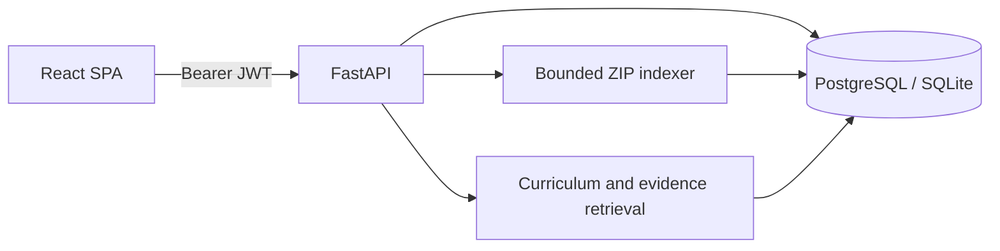

# Architecture

## Runtime

The Vite React SPA calls the FastAPI API. SQLAlchemy persists users, organizations, memberships, projects, source files, and extracted symbols in Postgres (Compose) or SQLite (development). All endpoints that access a project resolve the signed-in user's membership before returning project data. API schema is available via FastAPI OpenAPI at `/docs`.

## Modules

- `backend/app/core`: environment configuration, SQLAlchemy session, token and access dependencies.
- `backend/app/models`: tenant and source-index entities.
- `backend/app/services`: parsing/indexing and deterministic onboarding/mentor logic.
- `backend/app/main.py`: HTTP routes and request-level orchestration.
- `frontend/src/lib/api.ts`: bearer token and typed fetch wrapper.
- `frontend/src/main.tsx`: account, workspace, project, upload, source, learning, and mentor views.

## API surface

| Route | Purpose |
| --- | --- |
| `POST /api/v1/auth/register`, `/login` | Account and initial organization / session |
| `GET /api/v1/me` | User profile and organization memberships |
| `GET/POST /api/v1/projects` | List accessible projects / create in a member organization |
| `POST /api/v1/projects/{id}/upload` | Validate ZIP and atomically replace project index after archive checks |
| `GET .../files`, `.../symbols`, `.../architecture` | Inspect indexed source and rough component structure |
| `GET .../curriculum?role=backend` | Three-day curriculum outline |
| `POST .../mentor` | Evidence-aware answer envelope with file and line citations |
| `GET .../readiness` | Initial readiness signal scaffold |

## Data and tenancy

Each project belongs to exactly one organization. Membership checks scope project reads and writes. Membership roles are stored, and `viewer` cannot upload, but role management and fine-grained route policies are not implemented yet. Source text is stored in the database for retrieval. Source retention, deletion, backup, and customer-managed encryption policies need to be completed before production use.
